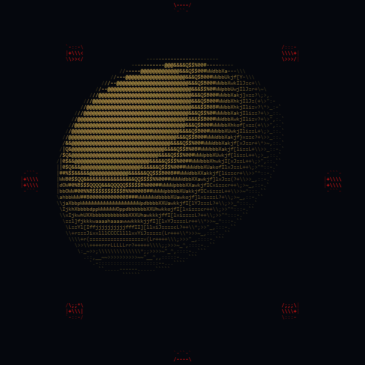
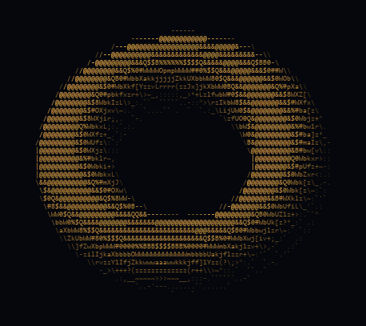

# ascii-art-hd

A [Claude](https://claude.ai) skill (plus a standalone CLI) that turns **images, GIFs and 3D `.obj` meshes** into **high-resolution, per-character-colour ASCII art** — still or animated/rotating.




*(Both examples are generated procedurally by the project's own test scripts; no third-party artwork.)*

## Why
Recognisable ASCII art (a horse's mane, armour plates, fur) needs **~160–260 columns, colour per character and a real source**. Hand-assembled low-resolution 3D blobs don't read as animals. This tool measures the real ink density of your font, shades with smooth light and shadow (realistic look; outline characters `- | / \` are optional via `--edges` for line art), and keeps the dark background empty so it works on transparent overlays.

## Install
```bash
pip install pillow numpy
```

## Use as a CLI
```bash
# still image
python ascii-art-hd/scripts/ascii_hd.py image photo.png --cols 220 --formats png,html,txt

# animated GIF
python ascii-art-hd/scripts/ascii_hd.py frames anim.gif --cols 120 --formats html,json

# rotating 3D model (Z-up Blender export, 48 frames per turn)
python ascii-art-hd/scripts/ascii_hd.py obj model.obj --up z --frames 48 --pitch 20 --mesh-color "#d4a050" --formats html,json

# portrait / person photo: crop to the subject, soft shading, lifted shadows
python ascii-art-hd/scripts/ascii_hd.py image person.jpg --cols 200 --autocrop --shadow-lift 0.6 --gamma 0.7 --min-brightness 0.45 --bg-threshold 0.10 --formats png,html
```

New-ish options worth knowing:

| Option | What it does |
|---|---|
| `--charset smooth\|detailed\|<chars>` | `smooth` (default) = ` .:;+*%#$@`, reads as shading; `detailed` = 70 characters (can look like text when small) |
| `--crop x0,y0,x1,y1` / `--autocrop` | crop by 0..1 fractions / to the most prominent bright subject (dim set pieces stay out; `--autocrop all` = every non-background cell); one box for all frames |
| `--shadow-lift 0..1` | opens dark tones (dark saturated clothing) without blowing highlights; 0 = off |
| `--bg-mode flood` | also drops dim cells connected to the border, each border cell seeding with its own colour (dim panels touching the edge); `--bg-tolerance` (colour step), `--bg-flood-max` (brightness ceiling, keeps the fill out of the subject) |

Run `--help` on a sub-command for every option. Outputs: `txt`, `ansi`, `html` (animated), `png`, and `json` ([ASCII Mate](https://github.com/naytngard/ascii-mate) `.ascii.json`, palette ≤ 62 colours).

## Use as a Claude skill
Zip the `ascii-art-hd/` folder (or use the prebuilt `ascii-art-hd.skill`) and add it as a skill in Claude. Then ask e.g. *"make a high-res colour ASCII version of this picture"* or *"turn this .obj into a rotating ASCII animation"*. The skill tells Claude to preview the PNG before delivering and to be honest about limits.

## Tests
```bash
pip install -r requirements-dev.txt
python -m pytest tests -q
```
CI runs the same on Ubuntu and Windows (Python 3.10 and 3.13).

## Limits
- Needs a real source image/mesh; it converts, it does not invent.
- OBJ rendering is pure NumPy (fine to ~10k triangles), single colour, no textures.
- Respect copyright: only convert artwork you own or that is CC0/permissively licensed.

## Türkçe özet
Görüntü, GIF veya 3B `.obj` modelini **yüksek çözünürlüklü, karakter başına renkli ASCII sanatına** çevirir (durağan, hareketli veya dönen). Tanınabilir sonuç için ~160–260 sütun, gerçek bir kaynak (resim/mesh) ve renk gerekir; elle kurulmuş 50×24'lük şekiller hayvan gibi görünmez. Kurulum: `pip install pillow numpy`. Kullanım için yukarıdaki komutlara bakın. Çıktılar: txt, ansi, html, png ve ASCII Mate `.ascii.json`. Telif: yalnızca kendi eserinizi veya CC0/serbest lisanslı kaynakları dönüştürün.

## License
MIT — see [LICENSE](LICENSE).
